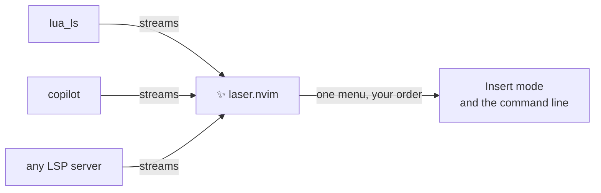

<!-- Focus on attracting users. Details belong in doc/laser.txt -->

# ✨ laser.nvim

**LA**nguage **SER**vice-oriented completion for Neovim.

Your language servers already know what comes next. laser.nvim puts it in front of you.

- 🔌 **Start with your existing LSP setup.** No separate completion sources to configure — laser uses the servers already attached to your buffer.
- 🌊 **Stream suggestions as they arrive.** Browse results without waiting for every server, or for the full stream, to finish.
- 🧘 **Stay steady while results land.** Once you start navigating, visible candidates and your selection hold still.
- ⌨️ **Complete on the command line too.** LSP-powered suggestions for `:` commands, with the same keys as Insert mode.

> [!WARNING]
> 🚧 Experimental. Options and behavior may change.



## 🎯 Make it yours

- **Choose servers and their order.** Show `lua_ls` first, turn off the ones you don't want, or set a timeout for slow ones.
- **Fuzzy matching out of the box.** Matches are highlighted, and with an empty input you see the server's own ranking. Bring your own matchers, sorters and converters when you want more.
- **Documentation at a glance.** Turn on `menu.preview` to show docs for the selected candidate beside the menu.
- **Edits that just work.** Confirming applies the server's edits, auto-imports included, and snippets expand.
- **Familiar looks.** The menu uses the same `Pmenu` highlight groups as Neovim's built-in popup menu.

## 🚀 Quick start

You need Neovim 0.11+ and a language server that supports completion.

Install `atusy/laser.nvim` with your plugin manager. No `setup()` is needed. Ask for completion as you type, and map the keys:

```lua
local laser = require("laser")

vim.api.nvim_create_autocmd({ "InsertEnter", "TextChangedI" }, {
  group = vim.api.nvim_create_augroup("my-completion", { clear = true }),
  callback = function()
    laser.complete()
  end,
})

-- Act on the menu while it is open; otherwise keep the key's own behavior.
local function map(key, action)
  vim.keymap.set({ "i", "c" }, key, function()
    if laser.visible() then
      action()
    else
      vim.api.nvim_feedkeys(vim.keycode(key), "in", false)
    end
  end)
end
map("<C-n>", function() laser.select(1) end)
map("<C-p>", function() laser.select(-1) end)
map("<C-y>", laser.confirm)
map("<C-e>", laser.cancel)
```

That's it. Start typing in a buffer with a language server attached.

Want it on the command line as well? Call `laser.complete({ language_id = "vim" })` on `CmdlineEnter` and `CmdlineChanged` for `:` with a server enabled for the `vim` filetype. Other command lines, such as `/`, work with any `language_id` you have a server for (see `:help laser-cmdline`).

## 📖 Learn more

Everything else — server order, per-client options, the menu, the preview, custom filters and refresh rules — is in the help:

```vim
:help laser
```

Or read [doc/laser.txt](doc/laser.txt) on GitHub.

## License

MIT
